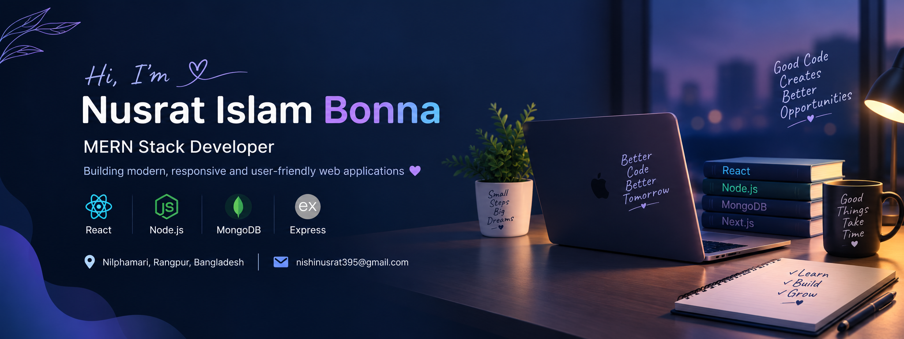

  <h3>Building modern, responsive and user-friendly web applications</h3>

  

---

## 👩‍💻 About Me

Hi! I'm **Nusrat Islam Bonna**, 
a developer from Bangladesh who enjoys building modern web applications and learning new technologies.

- 💻 Focused on **Frontend Development and the MERN Stack**.
- ⚛️ Building web applications using **React.js, JavaScript, and Tailwind CSS**.
- 🌐 Exploring full-stack development with **Node.js, Express.js, and MongoDB**.
- 🚗 Developed **RentWheels**, a car rental platform project.
- 🎟️ Worked on **TicketBari**, an online ticket booking platform.
- 🌿 Built **Organic Rizq** using Next.js.
- 🤖 Worked on **Nexthire**, an AI-powered resume project.
- 🎨 Created a personal portfolio to showcase my projects and development skills.
- 📚 Continuously learning, solving programming problems, and improving my coding skills.
- 🤝 Interested in collaborating on meaningful web development projects.

## 🛠️ Technical Skills

  

## 🤝 Connect With Me

  
  
  

---

## 📊 GitHub Statistics

  

## 🔥 Contribution Streak

  

## 🐍 Contribution Graph

  

---

  <i>"Keep learning, keep building, and keep growing."</i>

